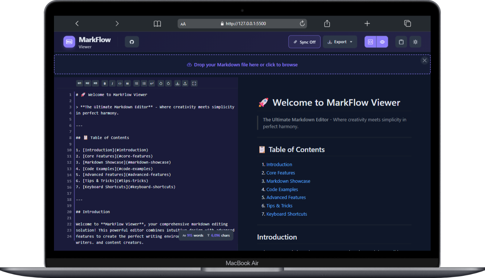
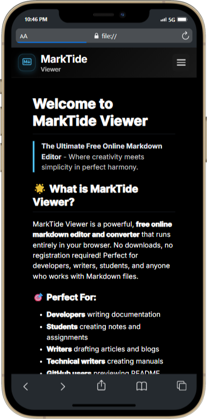

# MarkTide

## Markdown editor and converter

Write Markdown, read a live preview, and export documents with consistent formatting. See [GitHub Releases](https://github.com/zigzag-007/MarkTide-Viewer/releases) for updates and known issues.

[](https://marktide.netlify.app/)
[](https://marktide.vercel.app/)
[](https://github.com/zigzag-007/MarkTide-Viewer/stargazers)
[](LICENSE)
[](https://marktide.netlify.app/)
[](https://marktide.netlify.app/)

**Write. Preview. Export. All in your browser. No login. No cost.**

[🚀 Launch Stable MarkTide](https://marktide.netlify.app/) | [🧪 Development Preview](https://marktide.vercel.app/) | [🐛 Report Bug](https://github.com/zigzag-007/MarkTide-Viewer/issues) | [💡 Request Feature](https://github.com/zigzag-007/MarkTide-Viewer/issues)

---

## 📸 Preview

| Desktop                                         | Mobile                                        |
| ----------------------------------------------- | --------------------------------------------- |
|  |  |

---

## ✨ What is MarkTide?

MarkTide is a Markdown editor that processes documents in your browser, without an account or a hosted document conversion service. Write Markdown, see a live preview, and export to PDF, HTML, or plain text. The main app uses bundled libraries and fonts. Remote document images and some resources in exported HTML can still make network requests.

---

## 🎯 Who Is It For?

|      👨‍💻 Developers       |          🎓 Students          |      ✍️ Writers      | 🛠️ Technical Writers |
| :----------------------: | :---------------------------: | :------------------: | :------------------: |
| API docs, READMEs, specs | Notes, reports, thesis drafts | Blog posts, articles |   Manuals, guides    |

---

## 💡 Key Features

### 📝 Editor

- **Monaco-powered** editor (same engine as VS Code)
- Real-time live preview with scroll sync
- Syntax highlighting with the bundled Highlight.js language set
- Drag & drop `.md` file support
- Formatting toolbar: bold, italic, code, lists, and more

### 🔄 Export & Conversion

- **Markdown to PDF** - browser print dialog with Save as PDF
- **Markdown to HTML** - web-ready with styles
- **Markdown to Plain Text** - stripped for any use
- GitHub Flavored Markdown tables, task lists, and fenced code, plus selected extensions

### 🎨 Experience & Design

- Beautiful **dark & light themes** with smooth radial transitions
- **Split-screen** editor and preview layout
- Responsive editor layout for narrow and wide screens
- Keyboard shortcuts for power users

### 🚀 Advanced Capabilities

- 📊 **Mermaid diagrams** - flowcharts, sequence diagrams, and more
- 🧮 **LaTeX math expressions** - powered by MathJax
- ✅ Task lists, tables, and fenced code blocks
- 😊 Emoji support
- 🖨️ Print-friendly layouts
- Footnotes, highlighted text (`==text==`), and abbreviation definitions

### Export behaviour and limits

PDF export prepares a separate print document and opens the browser print dialog. Choose Save as PDF there. It uses shared Markdown styles plus deliberate print rules for typography, A4 margins, wrapping, and pagination. The suggested filename comes from the document title; the browser controls the final save name. Page breaks can change with fonts, content, and print settings. Fully dark PDF pages are not an accepted feature.

HTML export includes document styles and code/diagram controls. Fonts, MathJax, Mermaid and some other resources still use pinned CDN links, so exported HTML is not fully offline. Remote document images may need a network connection. Hard reload before creating a fresh export after JavaScript changes; existing exports retain their original code.

Known issue: an unclosed raw HTML `<Title>` placeholder in a heading can consume the following document content. This was reproduced in Preview, and a fresh HTML export contained the later markup inside a body `title` element. Its handling remains under review; PDF behaviour has not been checked for this reproduction.

---

## ⚡ Quick Start

No installation needed. Choose which version you want to use:

- **[Stable version on Netlify](https://marktide.netlify.app/)**<br>
  Deployed from `main`. Recommended for everyday use.

- **[Development preview on Vercel](https://marktide.vercel.app/)**<br>
  Deployed from `dev`. Includes improvements that may not yet be available in the stable version. Features may change, and bugs may occur.

The two sites may run different versions. Updates reach the stable version after testing and integration.

1. **Type** your Markdown, or **drag & drop** an `.md` file
2. **Preview** updates live in real-time
3. **Export** to PDF, HTML, or Text in one click

---

## 🛠️ Technology Stack

| Layer               | Technology                                                  |
| :------------------ | :---------------------------------------------------------- |
| Frontend            | Vanilla JavaScript, HTML5, CSS3                             |
| Editor Engine       | [Monaco Editor](https://microsoft.github.io/monaco-editor/) |
| Markdown Processing | [Marked.js](https://marked.js.org/)                         |
| Syntax Highlighting | [Highlight.js](https://highlightjs.org/)                    |
| PDF Export          | Browser printing through `PrintHandler.printPreview()`   |
| Math Rendering      | [MathJax](https://www.mathjax.org/)                         |
| Diagrams            | [Mermaid.js](https://mermaid.js.org/)                       |
| Theme Transitions   | View Transitions API + ripple fallback                      |

---

## 🔧 Local Development

```bash
# 1. Clone the repository
git clone https://github.com/zigzag-007/MarkTide-Viewer.git

# 2. Navigate to the project folder
cd MarkTide-Viewer

# 3. Serve the static project, no build step needed
python3 -m http.server 5173
```

Open `http://localhost:5173/` in your browser. A static server is recommended instead of opening `index.html` as a local file.

Application code lives in `index.html`, `assets/js`, and `assets/css`. Exact bundled dependencies and their license notices live in `assets/vendor`. Shared document CSS, Markdown parsing, sanitizing, MathJax, Mermaid, and code rendering serve Preview and exports; PDF layout rules live in `assets/js/print-styles.js`.

### Automated checks

The separate test workspace is in `tests`. On a new machine, install its dependencies with `npm install --prefix tests` and Chromium with `npm run install:browser --prefix tests`. Node 18 or newer is required by that workspace.

```bash
# Logic checks only, no browser or PDF export
npm run test:logic --prefix tests

# Quick checks, includes Chromium browser tests
npm test --prefix tests

# Full suite, includes browser and real PDF export checks
npm run test:full --prefix tests

# Optional live CDN health check
npm run test:cdn --prefix tests
```

The 18 tracked Markdown fixtures include supported syntax, unsupported syntax and deliberate edge cases. Rendering without errors does not prove every feature is supported. Use the tests at this release snapshot rather than importing later application features. HTML tests mirror pinned CDN libraries, so they do not verify live CDN availability. Real PDF checks use Poppler tools; some optional checks skip without their required tools or review settings. Record skips separately. Dependencies and generated test output stay ignored.

---

## 📱 Browser Support

Candidate browser checks target Chromium. Firefox, Safari, Edge, and actual mobile device behaviour need separate verification; this README does not claim a tested browser matrix.

---

## 🤝 Contributing

Contributions, bug reports, and feature requests are all welcome!

1. **Fork** the repository
2. **Create** a feature branch → `git checkout -b feature/YourFeature`
3. **Commit** your changes → `git commit -m 'feat: add your feature'`
4. **Push to your fork** → `git push origin feature/YourFeature`
5. **Open** a Pull Request

Please check the [open issues](https://github.com/zigzag-007/MarkTide-Viewer/issues) before submitting new ones.

Use a clear commit subject such as `feat(editor): add a formatting shortcut`. Release history and known issues belong in [GitHub Releases](https://github.com/zigzag-007/MarkTide-Viewer/releases).

---

## 📄 License

This project is licensed under **Apache License 2.0**. See [LICENSE](LICENSE) for the terms. Bundled third party packages retain their own licenses and notices in `assets/vendor/licenses`.

---

## 👨‍💻 Author

**Zig Zag** | [GitHub](https://github.com/zigzag-007) | [MarkTide](https://marktide.netlify.app/)

Built with ❤️ by Dark Net Studio

---

## ⭐ Support the Project

If MarkTide has been useful to you, consider giving it a star. It helps others discover it!

[](https://github.com/zigzag-007/MarkTide-Viewer/stargazers)

> 🐛 Found a bug? [Report it here](https://github.com/zigzag-007/MarkTide-Viewer/issues)
> 💡 Got an idea? [Suggest a feature](https://github.com/zigzag-007/MarkTide-Viewer/issues)

---

Free | Open Source | No Registration | Works in Your Browser

[🚀 Launch Stable MarkTide](https://marktide.netlify.app/)
