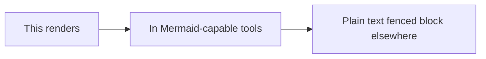

# 13  Markdown Flavor Compatibility Matrix

> **Test Purpose:** Test the same syntax across CommonMark, GFM, MultiMarkdown, Pandoc, and Obsidian dialects.  
> **What to look for:** Which elements render vs. show raw syntax  reveals your viewer's supported flavor.

---

## Flavor Overview

| Feature                       | CommonMark | GFM | Pandoc | MMD | Obsidian |
|-------------------------------|:----------:|:---:|:------:|:---:|:--------:|
| **Headings (ATX)**            | ✅         | ✅  | ✅     | ✅  | ✅       |
| **Headings (Setext)**         | ✅         | ✅  | ✅     | ✅  | ✅       |
| **Bold / Italic**             | ✅         | ✅  | ✅     | ✅  | ✅       |
| **Fenced Code Blocks**        | ✅         | ✅  | ✅     | ✅  | ✅       |
| **Indented Code Blocks**      | ✅         | ✅  | ✅     | ✅  | ✅       |
| **Blockquotes**               | ✅         | ✅  | ✅     | ✅  | ✅       |
| **Ordered / Unordered Lists** | ✅         | ✅  | ✅     | ✅  | ✅       |
| **Horizontal Rules**          | ✅         | ✅  | ✅     | ✅  | ✅       |
| **Links (inline)**            | ✅         | ✅  | ✅     | ✅  | ✅       |
| **Images**                    | ✅         | ✅  | ✅     | ✅  | ✅       |
| **GFM Tables**                | ❌         | ✅  | ✅     | ✅  | ✅       |
| **Strikethrough ~~text~~**    | ❌         | ✅  | ✅     | ✅  | ✅       |
| **Task Lists - [ ]**          | ❌         | ✅  | ❌     | ❌  | ✅       |
| **GFM Autolinks (bare URL)**  | ❌         | ✅  | ✅     | ✅  | ✅       |
| **Footnotes [^1]**            | ❌         | ❌  | ✅     | ✅  | ✅       |
| **Definition Lists**          | ❌         | ❌  | ✅     | ✅  | ❌       |
| **Math $...$**                | ❌         | ❌  | ✅     | ✅  | ✅       |
| **Mermaid diagrams**          | ❌         | ❌  | ❌     | ❌  | ✅       |
| **Highlight ==text==**        | ❌         | ❌  | ❌     | ❌  | ✅       |
| **Subscript H~2~O**           | ❌         | ❌  | ✅     | ✅  | ✅       |
| **Superscript x^2^**          | ❌         | ❌  | ✅     | ✅  | ✅       |
| **Wikilinks [[Page]]**        | ❌         | ❌  | ❌     | ❌  | ✅       |
| **Callouts > [!NOTE]**        | ❌         | ❌  | ❌     | ❌  | ✅       |
| **GitHub Alerts > [!NOTE]**   | ❌         | ext | ❌     | ❌  | plugin   |
| **Front Matter YAML**         | ❌         | ❌  | ✅     | ✅  | ✅       |
| **Abbreviations *[abbr]: def**| ❌         | ❌  | ❌     | ❌  | plugin   |
| **Heading Attributes {#id}**  | ❌         | ❌  | ✅     | ✅  | ❌       |

---

## Test Group 1: CommonMark Core (must work everywhere)

This **bold** and *italic* text must render in any Markdown viewer.

> This blockquote must render in any Markdown viewer.

- Unordered list item A
- Unordered list item B

1. Ordered list item 1
2. Ordered list item 2

```
Plain code block (no language tag) — universal.
```

[Link text](https://example.com)

---

## Test Group 2: GFM Extensions (GitHub, Obsidian, HackMD...)

~~Strikethrough~~  GFM only, shows as `~~text~~` in plain CommonMark.

https://example.com  Bare URL autolink; shows as plain text in strict CommonMark.

| GFM | Table | Test |
|-----|-------|------|
| A   | B     | C    |

- [x] GFM task list item

---

## Test Group 3: Pandoc Extensions

Definition term
:   This is a definition list item  Pandoc/MultiMarkdown only.

Here is a sentence with a Pandoc footnote.[^pandoc test]

[^pandoc-test]: This footnote renders in Pandoc, Obsidian, HackMD. On GitHub it renders as literal text.

---

## Test Group 4: Obsidian Specific

==This highlight==  Obsidian/Typora/HackMD only. Shows as `==text==` on GitHub.

H~2~O  subscript  Pandoc/Typora/Obsidian. Shows as `H~2~O` on GitHub.

x^2^  superscript  Pandoc/Typora/Obsidian. Shows as `x^2^` on GitHub.

[[Wikilink Example]]  Obsidian/Foam only. Shows as literal `[[Wikilink Example]]` on GitHub.

> [!NOTE]
> Obsidian callout  renders styled in Obsidian; shows as plain blockquote on GitHub.

---

## Test Group 5: GitHub Alerts (GitHub only)

> [!NOTE]
> GitHub Alert  NOTE type. Renders with blue sidebar on GitHub; plain blockquote in Obsidian (unless plugin installed).

> [!TIP]
> GitHub Alert  TIP type.

> [!IMPORTANT]
> GitHub Alert  IMPORTANT type.

> [!WARNING]
> GitHub Alert  WARNING type.

> [!CAUTION]
> GitHub Alert  CAUTION type.

---

## Test Group 6: Math (Obsidian, HackMD, GitHub, Typora, Pandoc)

Inline: $E = mc^2$

Block:

$$
\int_{-\infty}^{\infty} e^{-x^2}\,dx = \sqrt{\pi}
$$

Shows as literal `$...$` and `$$...$$` in VS Code (built in), Notion, plain CommonMark.

---

## Test Group 7: Mermaid (Obsidian, VS Code+ext, HackMD, GitHub)



---

## Test Group 8: Hard Line Break Methods

**Method 1  Two trailing spaces (invisible in most editors):**

Line A (followed by two spaces)  
Line B (should be on new line)

**Method 2  Backslash at end (CommonMark, Pandoc):**

Line C\
Line D

**Method 3  HTML `<br>` (universally supported where HTML is allowed):**

Line E<br>
Line F

---

## Test Group 9: Heading Syntax Edge Cases

### ATX heading (standard)  `###`

This heading above uses hash marks  universal.

Setext H1 below (alt syntax  some parsers only):

Setext Level One Heading
========================

Setext Level Two Heading
------------------------

#No space heading  fails in CommonMark, may work in legacy parsers.

---

## Test Group 10: Autolink Varieties

**CommonMark angle bracket autolinks (works everywhere):**

<https://example.com>

<user@example.com>

**GFM bare URL autolinks (GFM+ only):**

https://example.com

www.example.com

user@example.com

**These should NOT autolink (too ambiguous):**

example.com (no protocol or www)

sometext@context (not a valid email pattern)
