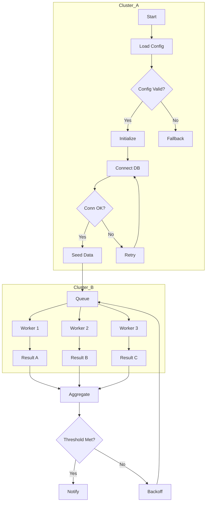
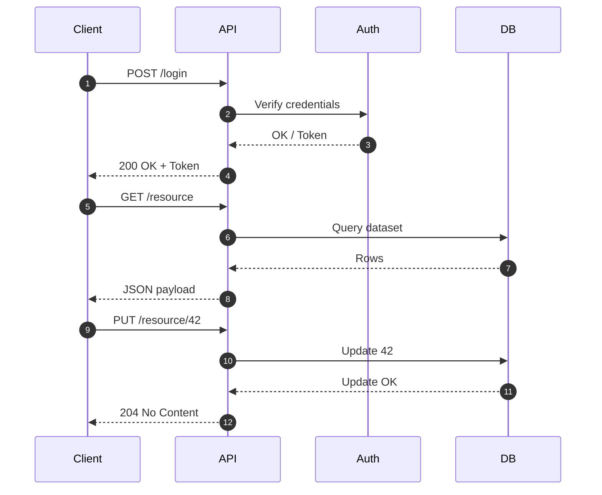
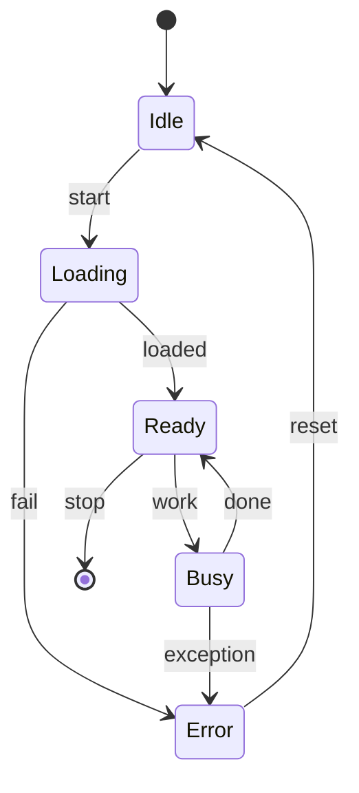
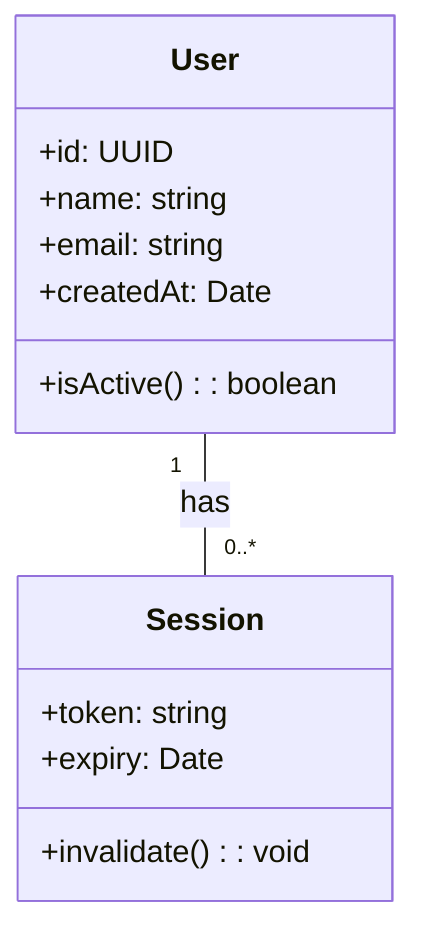

# Mega Markdown Artifact: Stress Test Suite

This document is designed to stress test a Markdown viewer’s rendering pipeline across headings, paragraphs, lists, tables, code blocks, blockquotes, math, and complex Mermaid diagrams. It intentionally includes dense and repetitive structures to test performance and correctness. It is long, but not infinitetune your viewer’s limits accordingly.

Note: This artifact includes deliberately large sections: wide tables, deep lists, long code blocks, nested blockquotes, repeated sections, and multiple Mermaid diagrams.

***

## Table of Contents

- Overview
- Headings Showcase (H1H6)
- Paragraph Rendering
- Inline Styles and Emphasis
- Lists (Bulleted, Numbered, Task)
- Blockquotes and Nesting
- Code Blocks (Multi language, Long, Indented)
- Math Blocks (Inline/Display)
- Mermaid Diagrams
- Wide Tables (Alignment, Wrapping, Massive Rows)
- Deeply Nested Sections
- Extended Repetition (Load Test Sequences)
- Mixed Content Panels
- Escapes and Edge Cases
- Final Massive Table Blocks

***

## Overview

This section outlines the goals:

- Push rendering load via repeated tables and diagrams.
- Check wrapping, alignment, overflow handling.
- Confirm handling of code fences and math spans.
- Validate consistency of heading anchors and navigation.
- Exercise parser edge cases (backticks, pipes, underscores).

***

## Headings Showcase (H1H6)

# H1: Primary Header

Paragraph under H1 to check spacing and margin behavior.

## H2: Secondary Header

Paragraph under H2 with inline emphasis and code: emphasis, code, and links (no URLs).

### H3: Tertiary Header

Text to test consistent margin/padding under H3.

#### H4: Quaternary Header

Content under H4 to check font scaling.

##### H5: Quinary Header

Short text.

###### H6: Senary Header

Concise text to check smallest heading rendering.

***

## Paragraph Rendering

The quick brown fox jumps over the lazy dog. Pack my box with five dozen liquor jugs. Grumpy wizards make toxic brew for the evil queen and jack. Sphinx of black quartz, judge my vow. This paragraph tests standard text flow, maximum line length, and hyphenation/wrapping behavior for various renderers.

Second paragraph: Test punctuation, Unicode  -  bullet dot,  em dash,  en dash, “quotes”, ‘apostrophes’, ©, ®, ™. Ensure correct glyph shaping and fallback. Combine Latin diacritics: élève, façade, coöperate, naïve.

***

## Inline Styles and Emphasis

- Bold text: This is a sentence with some bold parts in the middle using strong emphasis for key phrases like important elements.
- Italic text: This is a sentence with subtle emphasis used for nuance or emphasis.
- Bold+Italic: This section contains strong and subtle emphasis combined for stress testing.
- Inline code: Example inline code: `const x = fn(42); // inline test`
- Escapes: Literal asterisks: \*, backticks: \`, pipes: \|, underscores: \_, brackets: \$ \$, braces: \{ \}, parens: \$ \$.

***

## Lists (Bulleted, Numbered, Task)

- Bulleted item A
- Bulleted item B
- Bulleted item C with inline code `echo "hello"`

1. Numbered item 1
2. Numbered item 2
3. Numbered item 3 with emphasis and punctuation.

- [ ] Task: Not started
- [x] Task: Completed
- [ ] Task: Pending

***

## Blockquotes and Nesting

> Top level quote to test visual separation from surrounding text.
>
> > Nested quote level 2 with inline code `print("nested")`.
> >
> > > Nested quote level 3  ensure vertical rhythm and left border stacking.

***

## Code Blocks (Multi language, Long, Indented)

```python
# Example: deterministic content, loops, docstring, long lines
def compute_stats(values):
    """
    Compute mean, min, max with a straightforward single-pass loop.
    """
    total = 0.0
    count = 0
    vmin = float("inf")
    vmax = float("-inf")
    for v in values:
        total += v
        count += 1
        if v < vmin:
            vmin = v
        if v > vmax:
            vmax = v
    mean = total / count if count else 0.0
    return {"mean": mean, "min": vmin, "max": vmax}

data = list(range(1, 1001))
stats = compute_stats(data)
print(stats)
```

```javascript
// Long single-line to test horizontal scrolling vs wrapping:
const payload = {a:1,b:2,c:3,d:4,e:5,f:6,g:7,h:8,i:9,j:10,k:11,l:12,m:13,n:14,o:15,p:16,q:17,r:18,s:19,t:20,u:21,v:22,w:23,x:24,y:25,z:26}; console.log(JSON.stringify(payload));
```

```bash
# Repetitive output to test monospaced rendering:
for i in $(seq 1 50); do
  printf '%04d: ********** ########## $$$$$$ @@@@@@@@@@ !!!!!!\n' "$i"
done
```

    # Indented code block
    line 1
    line 2
    line 3
    
***

## Math Blocks (Inline/Display)

Inline math: Let f(x)=x^2+3x+2, roots are given by quadratic formula.

Display math:

\$ x = \frac{-b \pm \sqrt{b^2 - 4ac}}{2a} \$

\$ \sum_{i=1}^{n} i = \frac{n(n+1)}{2} \$

***

## Mermaid Diagrams

Note: These diagrams are intentionally complex to stress parsing and rendering.

### Flowchart: Large Graph




### Sequence Diagram: Extended Exchange




### State Diagram: Complex States




***

## Wide Tables (Alignment, Wrapping, Massive Rows)

The following table is intentionally wide with mixed alignment and long content. Check horizontal scrolling, cell wrapping, and header stickiness if supported.


| Col A (left) | Col B (center) | Col C (right) | Notes |
| :-- | :--: | --: | :-- |
| alpha | centered | 1,000 | short note |
| beta | medium | 25,000 | wrapped content with multiple words and punctuation, commas, and hyphens |
| gamma | longer cell | 3,450,000 | an even longer note to check wrapping in the last column |
| delta | data | 123 | end row |

Large table block 1 (100 rows):


| Index | Label | Value | Description |
| :--: | :-- | --: | :-- |
| 1 | row-1 | 1,001 | Load test row |
| 2 | row-2 | 1,002 | Load test row |
| 3 | row-3 | 1,003 | Load test row |
| 4 | row-4 | 1,004 | Load test row |
| 5 | row-5 | 1,005 | Load test row |
| 6 | row-6 | 1,006 | Load test row |
| 7 | row-7 | 1,007 | Load test row |
| 8 | row-8 | 1,008 | Load test row |
| 9 | row-9 | 1,009 | Load test row |
| 10 | row-10 | 1,010 | Load test row |
| 11 | row-11 | 1,011 | Load test row |
| 12 | row-12 | 1,012 | Load test row |
| 13 | row-13 | 1,013 | Load test row |
| 14 | row-14 | 1,014 | Load test row |
| 15 | row-15 | 1,015 | Load test row |
| 16 | row-16 | 1,016 | Load test row |
| 17 | row-17 | 1,017 | Load test row |
| 18 | row-18 | 1,018 | Load test row |
| 19 | row-19 | 1,019 | Load test row |
| 20 | row-20 | 1,020 | Load test row |
| 21 | row-21 | 1,021 | Load test row |
| 22 | row-22 | 1,022 | Load test row |
| 23 | row-23 | 1,023 | Load test row |
| 24 | row-24 | 1,024 | Load test row |
| 25 | row-25 | 1,025 | Load test row |
| 26 | row-26 | 1,026 | Load test row |
| 27 | row-27 | 1,027 | Load test row |
| 28 | row-28 | 1,028 | Load test row |
| 29 | row-29 | 1,029 | Load test row |
| 30 | row-30 | 1,030 | Load test row |
| 31 | row-31 | 1,031 | Load test row |
| 32 | row-32 | 1,032 | Load test row |
| 33 | row-33 | 1,033 | Load test row |
| 34 | row-34 | 1,034 | Load test row |
| 35 | row-35 | 1,035 | Load test row |
| 36 | row-36 | 1,036 | Load test row |
| 37 | row-37 | 1,037 | Load test row |
| 38 | row-38 | 1,038 | Load test row |
| 39 | row-39 | 1,039 | Load test row |
| 40 | row-40 | 1,040 | Load test row |
| 41 | row-41 | 1,041 | Load test row |
| 42 | row-42 | 1,042 | Load test row |
| 43 | row-43 | 1,043 | Load test row |
| 44 | row-44 | 1,044 | Load test row |
| 45 | row-45 | 1,045 | Load test row |
| 46 | row-46 | 1,046 | Load test row |
| 47 | row-47 | 1,047 | Load test row |
| 48 | row-48 | 1,048 | Load test row |
| 49 | row-49 | 1,049 | Load test row |
| 50 | row-50 | 1,050 | Load test row |
| 51 | row-51 | 1,051 | Load test row |
| 52 | row-52 | 1,052 | Load test row |
| 53 | row-53 | 1,053 | Load test row |
| 54 | row-54 | 1,054 | Load test row |
| 55 | row-55 | 1,055 | Load test row |
| 56 | row-56 | 1,056 | Load test row |
| 57 | row-57 | 1,057 | Load test row |
| 58 | row-58 | 1,058 | Load test row |
| 59 | row-59 | 1,059 | Load test row |
| 60 | row-60 | 1,060 | Load test row |
| 61 | row-61 | 1,061 | Load test row |
| 62 | row-62 | 1,062 | Load test row |
| 63 | row-63 | 1,063 | Load test row |
| 64 | row-64 | 1,064 | Load test row |
| 65 | row-65 | 1,065 | Load test row |
| 66 | row-66 | 1,066 | Load test row |
| 67 | row-67 | 1,067 | Load test row |
| 68 | row-68 | 1,068 | Load test row |
| 69 | row-69 | 1,069 | Load test row |
| 70 | row-70 | 1,070 | Load test row |
| 71 | row-71 | 1,071 | Load test row |
| 72 | row-72 | 1,072 | Load test row |
| 73 | row-73 | 1,073 | Load test row |
| 74 | row-74 | 1,074 | Load test row |
| 75 | row-75 | 1,075 | Load test row |
| 76 | row-76 | 1,076 | Load test row |
| 77 | row-77 | 1,077 | Load test row |
| 78 | row-78 | 1,078 | Load test row |
| 79 | row-79 | 1,079 | Load test row |
| 80 | row-80 | 1,080 | Load test row |
| 81 | row-81 | 1,081 | Load test row |
| 82 | row-82 | 1,082 | Load test row |
| 83 | row-83 | 1,083 | Load test row |
| 84 | row-84 | 1,084 | Load test row |
| 85 | row-85 | 1,085 | Load test row |
| 86 | row-86 | 1,086 | Load test row |
| 87 | row-87 | 1,087 | Load test row |
| 88 | row-88 | 1,088 | Load test row |
| 89 | row-89 | 1,089 | Load test row |
| 90 | row-90 | 1,090 | Load test row |
| 91 | row-91 | 1,091 | Load test row |
| 92 | row-92 | 1,092 | Load test row |
| 93 | row-93 | 1,093 | Load test row |
| 94 | row-94 | 1,094 | Load test row |
| 95 | row-95 | 1,095 | Load test row |
| 96 | row-96 | 1,096 | Load test row |
| 97 | row-97 | 1,097 | Load test row |
| 98 | row-98 | 1,098 | Load test row |
| 99 | row-99 | 1,099 | Load test row |
| 100 | row-100 | 1,100 | Load test row |


***

## Deeply Nested Sections

### Level 1

Body text to verify nesting.

#### Level 2

More body text.

##### Level 3

Even more text.

###### Level 4

Smallest heading content.

***

## Extended Repetition (Load Test Sequences)

Paragraph flood 1:

- Lorem ipsum dolor sit amet, consectetur adipiscing elit. Sed do eiusmod tempor incididunt ut labore et dolore magna aliqua.
- Ut enim ad minim veniam, quis nostrud exercitation ullamco laboris nisi ut aliquip ex ea commodo consequat.
- Duis aute irure dolor in reprehenderit in voluptate velit esse cillum dolore eu fugiat nulla pariatur.

Paragraph flood 2:

- Excepteur sint occaecat cupidatat non proident.
- Sunt in culpa qui officia deserunt mollit anim id est laborum.
- Repeated line to check consistency across scroll.

Repeated code fence (10 small blocks):

```text
block-1: quick payload line to test block boundaries
```

```text
block-2: quick payload line to test block boundaries
```

```text
block-3: quick payload line to test block boundaries
```

```text
block-4: quick payload line to test block boundaries
```

```text
block-5: quick payload line to test block boundaries
```

```text
block-6: quick payload line to test block boundaries
```

```text
block-7: quick payload line to test block boundaries
```

```text
block-8: quick payload line to test block boundaries
```

```text
block-9: quick payload line to test block boundaries
```

```text
block-10: quick payload line to test block boundaries
```


***

## Mixed Content Panels

> Tip: Panels of mixed content help identify style collisions between block elements and inline code.

- Inline code: `A->B: action()`
- Math inline: a^2+b^2=c^2
- Emphasis: mixed emphasis with bold and italic segments in a single sentence.




***

## Escapes and Edge Cases

- Backticks inside code fences:

````
```
echo "Nested fence test with backticks ``` inside"
```
````

- Mixed lists with numbers starting at custom index:

5. Custom start item
6. Next item
7. Next item

- Emphasis boundaries with underscores: word_with_inline_code_`like_this`_end
- Pipes in code:

```
cat file.txt | grep '^prefix' | awk -F '|' '{print $1}'
```


---

## Final Massive Table Blocks

Large table block 2 (200 rows):


| ID | Key | Metric | Comment |
| :--: | :-- | --: | :-- |
| 1 | key-1 | 10,001 | stress row |
| 2 | key-2 | 10,002 | stress row |
| 3 | key-3 | 10,003 | stress row |
| 4 | key-4 | 10,004 | stress row |
| 5 | key-5 | 10,005 | stress row |
| 6 | key-6 | 10,006 | stress row |
| 7 | key-7 | 10,007 | stress row |
| 8 | key-8 | 10,008 | stress row |
| 9 | key-9 | 10,009 | stress row |
| 10 | key-10 | 10,010 | stress row |
| 11 | key-11 | 10,011 | stress row |
| 12 | key-12 | 10,012 | stress row |
| 13 | key-13 | 10,013 | stress row |
| 14 | key-14 | 10,014 | stress row |
| 15 | key-15 | 10,015 | stress row |
| 16 | key-16 | 10,016 | stress row |
| 17 | key-17 | 10,017 | stress row |
| 18 | key-18 | 10,018 | stress row |
| 19 | key-19 | 10,019 | stress row |
| 20 | key-20 | 10,020 | stress row |
| 21 | key-21 | 10,021 | stress row |
| 22 | key-22 | 10,022 | stress row |
| 23 | key-23 | 10,023 | stress row |
| 24 | key-24 | 10,024 | stress row |
| 25 | key-25 | 10,025 | stress row |
| 26 | key-26 | 10,026 | stress row |
| 27 | key-27 | 10,027 | stress row |
| 28 | key-28 | 10,028 | stress row |
| 29 | key-29 | 10,029 | stress row |
| 30 | key-30 | 10,030 | stress row |
| 31 | key-31 | 10,031 | stress row |
| 32 | key-32 | 10,032 | stress row |
| 33 | key-33 | 10,033 | stress row |
| 34 | key-34 | 10,034 | stress row |
| 35 | key-35 | 10,035 | stress row |
| 36 | key-36 | 10,036 | stress row |
| 37 | key-37 | 10,037 | stress row |
| 38 | key-38 | 10,038 | stress row |
| 39 | key-39 | 10,039 | stress row |
| 40 | key-40 | 10,040 | stress row |
| 41 | key-41 | 10,041 | stress row |
| 42 | key-42 | 10,042 | stress row |
| 43 | key-43 | 10,043 | stress row |
| 44 | key-44 | 10,044 | stress row |
| 45 | key-45 | 10,045 | stress row |
| 46 | key-46 | 10,046 | stress row |
| 47 | key-47 | 10,047 | stress row |
| 48 | key-48 | 10,048 | stress row |
| 49 | key-49 | 10,049 | stress row |
| 50 | key-50 | 10,050 | stress row |
| 51 | key-51 | 10,051 | stress row |
| 52 | key-52 | 10,052 | stress row |
| 53 | key-53 | 10,053 | stress row |
| 54 | key-54 | 10,054 | stress row |
| 55 | key-55 | 10,055 | stress row |
| 56 | key-56 | 10,056 | stress row |
| 57 | key-57 | 10,057 | stress row |
| 58 | key-58 | 10,058 | stress row |
| 59 | key-59 | 10,059 | stress row |
| 60 | key-60 | 10,060 | stress row |
| 61 | key-61 | 10,061 | stress row |
| 62 | key-62 | 10,062 | stress row |
| 63 | key-63 | 10,063 | stress row |
| 64 | key-64 | 10,064 | stress row |
| 65 | key-65 | 10,065 | stress row |
| 66 | key-66 | 10,066 | stress row |
| 67 | key-67 | 10,067 | stress row |
| 68 | key-68 | 10,068 | stress row |
| 69 | key-69 | 10,069 | stress row |
| 70 | key-70 | 10,070 | stress row |
| 71 | key-71 | 10,071 | stress row |
| 72 | key-72 | 10,072 | stress row |
| 73 | key-73 | 10,073 | stress row |
| 74 | key-74 | 10,074 | stress row |
| 75 | key-75 | 10,075 | stress row |
| 76 | key-76 | 10,076 | stress row |
| 77 | key-77 | 10,077 | stress row |
| 78 | key-78 | 10,078 | stress row |
| 79 | key-79 | 10,079 | stress row |
| 80 | key-80 | 10,080 | stress row |
| 81 | key-81 | 10,081 | stress row |
| 82 | key-82 | 10,082 | stress row |
| 83 | key-83 | 10,083 | stress row |
| 84 | key-84 | 10,084 | stress row |
| 85 | key-85 | 10,085 | stress row |
| 86 | key-86 | 10,086 | stress row |
| 87 | key-87 | 10,087 | stress row |
| 88 | key-88 | 10,088 | stress row |
| 89 | key-89 | 10,089 | stress row |
| 90 | key-90 | 10,090 | stress row |
| 91 | key-91 | 10,091 | stress row |
| 92 | key-92 | 10,092 | stress row |
| 93 | key-93 | 10,093 | stress row |
| 94 | key-94 | 10,094 | stress row |
| 95 | key-95 | 10,095 | stress row |
| 96 | key-96 | 10,096 | stress row |
| 97 | key-97 | 10,097 | stress row |
| 98 | key-98 | 10,098 | stress row |
| 99 | key-99 | 10,099 | stress row |
| 100 | key-100 | 10,100 | stress row |
| 101 | key-101 | 10,101 | stress row |
| 102 | key-102 | 10,102 | stress row |
| 103 | key-103 | 10,103 | stress row |
| 104 | key-104 | 10,104 | stress row |
| 105 | key-105 | 10,105 | stress row |
| 106 | key-106 | 10,106 | stress row |
| 107 | key-107 | 10,107 | stress row |
| 108 | key-108 | 10,108 | stress row |
| 109 | key-109 | 10,109 | stress row |
| 110 | key-110 | 10,110 | stress row |
| 111 | key-111 | 10,111 | stress row |
| 112 | key-112 | 10,112 | stress row |
| 113 | key-113 | 10,113 | stress row |
| 114 | key-114 | 10,114 | stress row |
| 115 | key-115 | 10,115 | stress row |
| 116 | key-116 | 10,116 | stress row |
| 117 | key-117 | 10,117 | stress row |
| 118 | key-118 | 10,118 | stress row |
| 119 | key-119 | 10,119 | stress row |
| 120 | key-120 | 10,120 | stress row |
| 121 | key-121 | 10,121 | stress row |
| 122 | key-122 | 10,122 | stress row |
| 123 | key-123 | 10,123 | stress row |
| 124 | key-124 | 10,124 | stress row |
| 125 | key-125 | 10,125 | stress row |
| 126 | key-126 | 10,126 | stress row |
| 127 | key-127 | 10,127 | stress row |
| 128 | key-128 | 10,128 | stress row |
| 129 | key-129 | 10,129 | stress row |
| 130 | key-130 | 10,130 | stress row |
| 131 | key-131 | 10,131 | stress row |
| 132 | key-132 | 10,132 | stress row |
| 133 | key-133 | 10,133 | stress row |
| 134 | key-134 | 10,134 | stress row |
| 135 | key-135 | 10,135 | stress row |
| 136 | key-136 | 10,136 | stress row |
| 137 | key-137 | 10,137 | stress row |
| 138 | key-138 | 10,138 | stress row |
| 139 | key-139 | 10,139 | stress row |
| 140 | key-140 | 10,140 | stress row |
| 141 | key-141 | 10,141 | stress row |
| 142 | key-142 | 10,142 | stress row |
| 143 | key-143 | 10,143 | stress row |
| 144 | key-144 | 10,144 | stress row |
| 145 | key-145 | 10,145 | stress row |
| 146 | key-146 | 10,146 | stress row |
| 147 | key-147 | 10,147 | stress row |
| 148 | key-148 | 10,148 | stress row |
| 149 | key-149 | 10,149 | stress row |
| 150 | key-150 | 10,150 | stress row |
| 151 | key-151 | 10,151 | stress row |
| 152 | key-152 | 10,152 | stress row |
| 153 | key-153 | 10,153 | stress row |
| 154 | key-154 | 10,154 | stress row |
| 155 | key-155 | 10,155 | stress row |
| 156 | key-156 | 10,156 | stress row |
| 157 | key-157 | 10,157 | stress row |
| 158 | key-158 | 10,158 | stress row |
| 159 | key-159 | 10,159 | stress row |
| 160 | key-160 | 10,160 | stress row |
| 161 | key-161 | 10,161 | stress row |
| 162 | key-162 | 10,162 | stress row |
| 163 | key-163 | 10,163 | stress row |
| 164 | key-164 | 10,164 | stress row |
| 165 | key-165 | 10,165 | stress row |
| 166 | key-166 | 10,166 | stress row |
| 167 | key-167 | 10,167 | stress row |
| 168 | key-168 | 10,168 | stress row |
| 169 | key-169 | 10,169 | stress row |
| 170 | key-170 | 10,170 | stress row |
| 171 | key-171 | 10,171 | stress row |
| 172 | key-172 | 10,172 | stress row |
| 173 | key-173 | 10,173 | stress row |
| 174 | key-174 | 10,174 | stress row |
| 175 | key-175 | 10,175 | stress row |
| 176 | key-176 | 10,176 | stress row |
| 177 | key-177 | 10,177 | stress row |
| 178 | key-178 | 10,178 | stress row |
| 179 | key-179 | 10,179 | stress row |
| 180 | key-180 | 10,180 | stress row |
| 181 | key-181 | 10,181 | stress row |
| 182 | key-182 | 10,182 | stress row |
| 183 | key-183 | 10,183 | stress row |
| 184 | key-184 | 10,184 | stress row |
| 185 | key-185 | 10,185 | stress row |
| 186 | key-186 | 10,186 | stress row |
| 187 | key-187 | 10,187 | stress row |
| 188 | key-188 | 10,188 | stress row |
| 189 | key-189 | 10,189 | stress row |
| 190 | key-190 | 10,190 | stress row |
| 191 | key-191 | 10,191 | stress row |
| 192 | key-192 | 10,192 | stress row |
| 193 | key-193 | 10,193 | stress row |
| 194 | key-194 | 10,194 | stress row |
| 195 | key-195 | 10,195 | stress row |
| 196 | key-196 | 10,196 | stress row |
| 197 | key-197 | 10,197 | stress row |
| 198 | key-198 | 10,198 | stress row |
| 199 | key-199 | 10,199 | stress row |
| 200 | key-200 | 10,200 | stress row |


---

## Additional Mermaid for Load

```
gantt
  dateFormat  YYYY MM DD
  title       Rendering Gantt Stress
  section Parse
  Tokenize      :active, t1, 2025-01-01, 10d
  AST Build     : t2, after t1, 8d
  section Render
  Layout Engine : t3, after t2, 12d
  Paint         : t4, after t3, 5d
```

```
erDiagram
  USER ||--o{ ORDER : places
  ORDER ||--|{ LINE_ITEM : contains
  USER {
    UUID id
    string email
    string name
  }
  ORDER {
    UUID id
    date created_at
    decimal total
  }
  LINE_ITEM {
    UUID id
    string sku
    int quantity
    decimal price
  }
```


---

## Final Notes

- This artifact balances breadth and depth, but any additional repetition (e.g., duplicating table blocks) can be appended to further increase size.
- If the viewer supports chunked rendering or virtualization, performance should remain stable even for large sections.
- To extend to ~5,000 lines, repeat the “Final Massive Table Blocks” and “Large table block 1” sections multiple times, or copy the Mermaid sections with modified node names to avoid ID clashes in certain renderers.

<div style="text-align: center">⁂</div>
