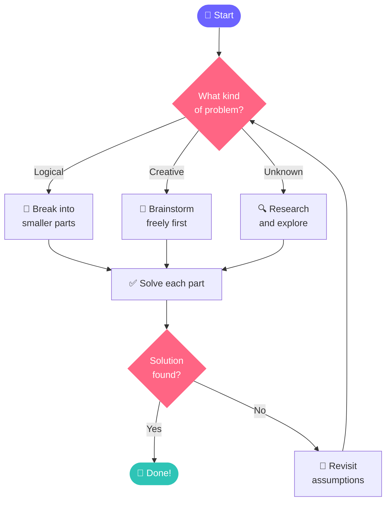
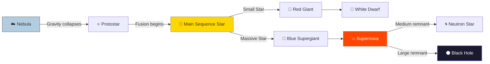
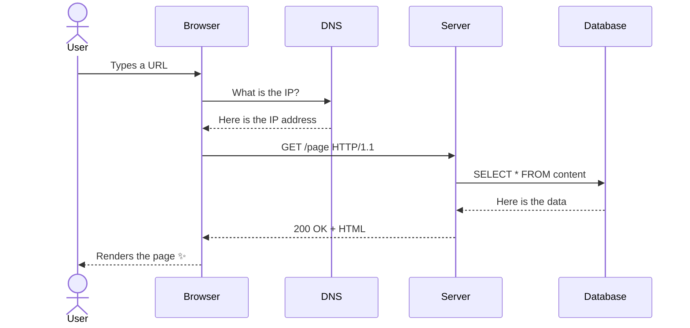
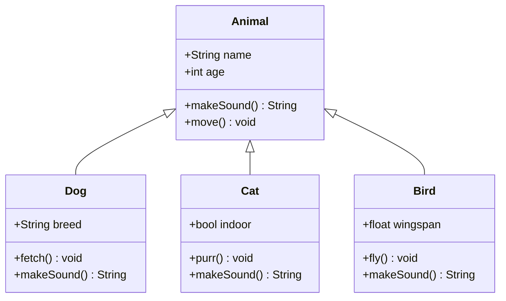
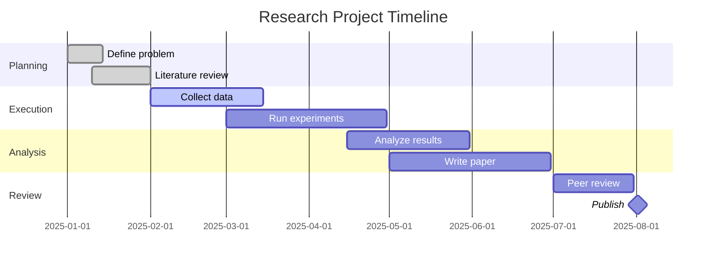
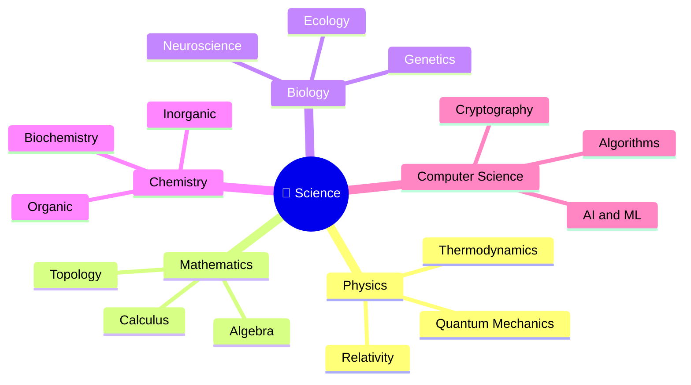

<div align="center">

# ✨ The Grand Markdown Showcase

### _A Living Document of Beauty, Structure, and Thought_


> _"To write beautifully is to think clearly."_
> Anonymous Scholar

</div>

## 📖 Table of Contents

| #   | Section                         | Theme                 |
| --- | ------------------------------- | --------------------- |
| 1   | [Typography](#typography)       | Words and Style       |
| 2   | [Mathematics](#mathematics)     | Equations and Proofs  |
| 3   | [Diagrams](#diagrams)           | Visual Thinking       |
| 4   | [Code](#code)                   | The Art of Logic      |
| 5   | [Data Tables](#data-tables)     | Structured Beauty     |
| 6   | [Checklists](#checklists)       | Progress and Purpose  |
| 7   | [Deep Thoughts](#deep-thoughts) | Philosophy of Science |

## 1. Typography

### Emphasis and Style

Plain text is fine. But **bold text shouts confidence**. And _italic text whispers meaning_. Together, **_bold italic text commands attention_**.

You can ~~strike through old ideas~~ and replace them with better ones.

Inline `code snippets` sit quietly inside sentences, like small technical gems.

You can write H<sub>2</sub>O with subscript, and note that E = mc<sup>2</sup> with superscript. You can even <mark>highlight key ideas</mark> using HTML inline.

### Blockquotes: Layers of Thought

> **Level 1:** The universe is under no obligation to make sense to you.
>
> > **Level 2:** But mathematics seems to understand it perfectly.
> >
> > > **Level 3:** Perhaps mathematics _is_ the universe, thinking about itself.

### Lists: Order from Chaos

**The Hierarchy of Knowledge:**

1. **Data** raw, unprocessed facts
   1. Numbers, signals, observations
   2. Collected but not yet understood
2. **Information** data with context
   - Organized into patterns
   - Named and categorized
3. **Knowledge** information with meaning
   - Connected to other ideas
   - Useful for decisions
4. **Wisdom** knowledge applied with judgment
   - Rare and hard to teach
   - The goal of all learning

**Unordered: Things That Matter**

- 🌌 The vastness of space
- 🧬 The elegance of DNA
- ⚛️ The strangeness of quantum mechanics
  - Superposition being in two states at once
  - Entanglement two particles, one destiny
  - Uncertainty knowing one thing means losing another
- 🔢 The unreasonable effectiveness of mathematics

## 2. Mathematics

### The Language of the Universe

The area of a circle is given by:

$$
A = \pi r^2
$$

The most beautiful equation in mathematics, Euler's Identity, connects five fundamental constants:

$$
e^{i\pi} + 1 = 0
$$

Einstein's field equations describe how mass curves spacetime:

$$
G_{\mu\nu} + \Lambda g_{\mu\nu} = \frac{8\pi G}{c^4} T_{\mu\nu}
$$

The Gaussian (normal) distribution, the shape of randomness:

$$
f(x) = \frac{1}{\sigma\sqrt{2\pi}} \, e^{-\frac{1}{2}\left(\frac{x-\mu}{\sigma}\right)^2}
$$

Fourier's transform, which turns time into frequency:

$$
\hat{f}(\xi) = \int_{-\infty}^{\infty} f(x)\, e^{-2\pi i x \xi}\, dx
$$

The Schrödinger equation, governing the quantum world:

$$
i\hbar \frac{\partial}{\partial t}\Psi(\mathbf{r},t) = \left[ -\frac{\hbar^2}{2m}\nabla^2 + V(\mathbf{r},t) \right] \Psi(\mathbf{r},t)
$$

The sum of all natural numbers, a surprising result:

$$
\sum_{n=1}^{\infty} \frac{1}{n^2} = \frac{\pi^2}{6}
$$

A beautiful continued fraction for the golden ratio $\varphi$:

$$
\varphi = 1 + \cfrac{1}{1 + \cfrac{1}{1 + \cfrac{1}{1 + \cdots}}}
$$

## 3. Diagrams

### The Architecture of a System



---

### The Life of a Star



---

### How a Request Travels the Web



---

### A Class Structure



---

### A Project Timeline



---

### The Mind Map of Science



---

## 4. Code

### Python: The Beauty of Recursion

```python
def fibonacci(n: int, memo: dict = {}) -> int:
    """
    Compute the nth Fibonacci number using memoization.
    Elegant, efficient, and recursive.
    """
    if n in memo:
        return memo[n]
    if n <= 1:
        return n
    memo[n] = fibonacci(n - 1, memo) + fibonacci(n - 2, memo)
    return memo[n]

# The first 10 Fibonacci numbers
sequence = [fibonacci(i) for i in range(10)]
print(f"Fibonacci sequence: {sequence}")
# Output: [0, 1, 1, 2, 3, 5, 8, 13, 21, 34]
```

---

### JavaScript: Async Elegance

```javascript
async function fetchStarData(starName) {
  try {
    const response = await fetch(`https://api.universe.io/stars/${starName}`);

    if (!response.ok) {
      throw new Error(`Star not found: ${starName}`);
    }

    const { name, mass, luminosity, age } = await response.json();

    return {
      name,
      mass: `${mass} solar masses`,
      luminosity: `${luminosity}L☉`,
      age: `${(age / 1e9).toFixed(2)} billion years`
    };

  } catch (error) {
    console.error("🚨 Error:", error.message);
  }
}
```

---

### SQL: Querying the Cosmos

```sql
-- Find the top 5 brightest stars in the observable universe
SELECT
    s.name                          AS star_name,
    s.constellation,
    ROUND(s.apparent_magnitude, 2)  AS brightness,
    ROUND(s.distance_ly, 0)         AS distance_light_years,
    s.spectral_class
FROM
    stars s
WHERE
    s.visible_to_naked_eye = TRUE
    AND s.apparent_magnitude < 1.5
ORDER BY
    s.apparent_magnitude ASC
LIMIT 5;
```

---

### Bash: The Shell Sings

```bash
#!/bin/bash
# A script that greets the universe beautifully

STARS=("Sirius" "Canopus" "Arcturus" "Vega" "Capella")

echo "🌌 Welcome to the Observatory"
echo "================================"

for star in "${STARS[@]}"; do
    echo "  ⭐ Observing: $star..."
    sleep 0.5
done

echo "================================"
echo "✅ All stars catalogued. Goodnight, Universe."
```

---

## 5. Data Tables

### Properties of the Planets

| Planet  |   Type    | Radius (km) | Moons | Avg Temp (°C) | Notable Feature  |
| :------ | :-------: | ----------: | ----: | :-----------: | :--------------- |
| Mercury |   Rocky   |       2,439 |     0 |      167      | Closest to Sun   |
| Venus   |   Rocky   |       6,051 |     0 |      464      | Hottest planet   |
| Earth   |   Rocky   |       6,371 |     1 |      15       | Life exists here |
| Mars    |   Rocky   |       3,389 |     2 |      -65      | Largest volcano  |
| Jupiter | Gas Giant |      69,911 |    95 |     -110      | Great Red Spot   |
| Saturn  | Gas Giant |      58,232 |   146 |     -140      | Iconic rings     |
| Uranus  | Ice Giant |      25,362 |    28 |     -195      | Rotates sideways |
| Neptune | Ice Giant |      24,622 |    16 |     -200      | Fastest winds    |

---

### Comparison of Sorting Algorithms

| Algorithm   |   Best Case   | Average Case  |  Worst Case   |    Space    | Stable |
| :---------- | :-----------: | :-----------: | :-----------: | :---------: | :----: |
| Bubble Sort |    $O(n)$     |   $O(n^2)$    |   $O(n^2)$    |   $O(1)$    |   ✅   |
| Merge Sort  | $O(n \log n)$ | $O(n \log n)$ | $O(n \log n)$ |   $O(n)$    |   ✅   |
| Quick Sort  | $O(n \log n)$ | $O(n \log n)$ |   $O(n^2)$    | $O(\log n)$ |   ❌   |
| Heap Sort   | $O(n \log n)$ | $O(n \log n)$ | $O(n \log n)$ |   $O(1)$    |   ❌   |
| Tim Sort    |    $O(n)$     | $O(n \log n)$ | $O(n \log n)$ |   $O(n)$    |   ✅   |

---

## 6. Checklists

### The Perfect Research Workflow

- [x] Define a clear research question
- [x] Review existing literature thoroughly
- [x] Choose an appropriate methodology
- [x] Collect and clean the data
- [ ] Perform statistical analysis
- [ ] Visualize the results meaningfully
- [ ] Write the first draft
- [ ] Revise with peer feedback
- [ ] Submit for publication
- [ ] Celebrate with good coffee ☕

---

### Learning Roadmap: Becoming a Data Scientist

- [x] **Foundations**
  - [x] Python basics
  - [x] Statistics and probability
  - [x] Linear algebra
- [x] **Core Skills**
  - [x] Pandas and NumPy
  - [x] Data visualization
  - [ ] Machine learning fundamentals
- [ ] **Advanced Topics**
  - [ ] Deep learning
  - [ ] Natural language processing
  - [ ] Reinforcement learning
- [ ] **Real World**
  - [ ] Kaggle competitions
  - [ ] Open source contributions
  - [ ] Research paper publication

---

## 7. Deep Thoughts

> **On the Nature of Knowledge**
>
> Science does not give us certainty. It gives us the best explanation we have _so far_, always open to revision. That is not a weakness. That is its greatest strength.

---

<div align="center">

### The Most Important Equation of All

$$
\boxed{ \text{Curiosity} + \text{Rigor} + \text{Time} = \text{Understanding} }
$$

---

_"The more clearly we can focus our attention on the wonders and realities of the universe about us, the less taste we shall have for destruction."_

Rachel Carson

---

**Made with** ❤️ **and Markdown**


</div>

---

_End of Document. The universe awaits your next question._
